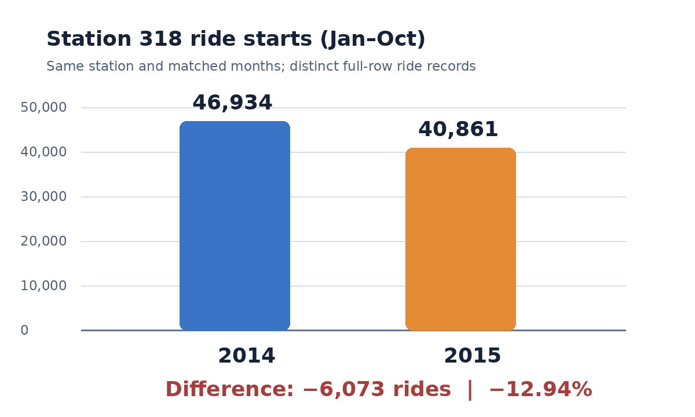

# Findings: Station 318 ride starts

## The gap

Station 318 (`E 43 St & Vanderbilt Ave`) recorded **46,934 distinct trip records** from January through October 2014 and **40,861** in the same months of 2015. One source row is one recorded trip. The analysis row is one station ID for one matched ten-month period.

That is **6,073 fewer recorded ride starts**, a **12.94% decrease**:

`40,861 - 46,934 = -6,073`

`(-6,073 / 46,934) × 100 = -12.94%`

## The benchmark

The benchmark is station 318 in January–October 2014. Comparing the same months controls for the seasonal calendar pattern. The BigQuery coverage check shows that 2014 and 2015 are complete calendar years overall, and the station-level review shows the same station name and coordinates for the months included in both periods. The comparison is descriptive; it does not identify a cause.

## Value and limits

The measured value is **6,073 fewer ride records over the matched ten-month period**. The trip table does not contain fare revenue per trip or enough payment information to price those rides. The New York State Comptroller notes that Citi Bike trip totals do not directly correspond to ridership revenue because revenue also includes memberships and only some fares are tied directly to individual trips. For that reason, this report does not label the change as lost revenue or assign it a dollar value.

## Chart

## Sources and method

- BigQuery public dataset: [NYC Citi Bike system data](https://citibikenyc.com/system-data)
- New York State Comptroller: [NYC Bike Share Program audit](https://www.osc.ny.gov/files/state-agencies/audits/pdf/sga-2026-23n5.pdf)
- Queries and cleaning choices: [sql/README.md](sql/README.md)
